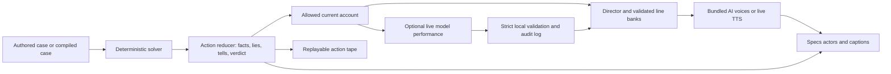

# Roomscript

**Clue meets L.A. Noire, in your room.** A one-player murder mystery for anyone who loves Clue and detective games. Question voiced suspects, pull memories from furniture, and carry their words to the evidence that proves them wrong. A deterministic TypeScript engine decides the truth; AI performs only within the account the engine permits.

Built for *Learn AR with SPECS*, directed by Wadood and implemented with coding agents, CLAD and the Lens Studio MCP. The repository is currently private; Wadood controls public release before submission. A final demo video and hero GIF are pending. The [capture gallery](docs/captures/) contains development evidence, not a finished trailer.

**Logic proven / feel unproven.** Work is verified in Lens Studio Preview with a simulated room. Physical Specs testing and the final integrated whole-case gate remain outstanding. The current checkpoint and blockers are in [PROGRESS](docs/PROGRESS.md).

Latest Run 7 pure suite: **504 tests across 57 files**, with pure-engine/tooling typecheck passed. Strict current-cast A2, twenty native pose textures, proximity and the voiced live-AI/Wren beat have passed. The final integrated gate for the new features remains pending. See [PROGRESS](docs/PROGRESS.md).

## The case

Edmund Harlow was found dead at 22:41. Qadir, Vale, Okafor and Pike each have something to hide. Ask a question, watch the suspect's tell, and compare their answer with what an object remembers. Drag a statement onto contradictory evidence to break the account. Make a who/where/with-what suggestion, collect independent proof, then hold the seal to accuse.

Run 7 now has two modes selectable from the crate. The latest pushed checkpoint is `8566d04`; the Dynamic evidence described below was established at `338b0db`. Final integration and visual acceptance remain separate.

| Mode | Working capability | Evidence and limits |
|---|---|---|
| **Preset — The Harlow Trust** (default) | Authored HARLOW-1041, tuned Evening Room anchors, prerecorded voices and a repeatable casting sweep | The **recorded scan** is seven objects from three distinct CameraModule viewpoints, detected by Claude Opus and located with World Query. Current-cast A2 hero passed; later presentation and continuous capture acceptance remain pending. |
| **Dynamic — Cast my room** | Live Preview CameraModule capture -> local Tooling detection -> World Query surfaces -> new verified case on detected furniture | The working file handoff reloads Preview when the model reply is ready. Strict `source=file` LEAF seeds **7, 1041, 2026** each reached a correct verdict with exact replay and zero binding errors. These three gates reused **one completed live scan** with six physical fixtures; they are not three independent fresh scans. |

Vision proposes fixtures, never facts about a murder. The compiler assigns explicitly fictional memories and proves a playable case. A failed/unavailable scan falls back to the recorded Preset. The saved seven-object scan and live six-object scan are separate evidence sets. This is real model processing of a **simulated room**, not proof of physical-room recognition or a seamless device workflow. See [scan provenance](Tooling/results/run7-room-scan/placement-evidence.json), [live seed 7 tape](Tooling/results/run7-file-seed7.json), [seed 1041](Tooling/results/run7-file-seed1041.json), [seed 2026](Tooling/results/run7-file-seed2026.json), and [current Run 7 checkpoint](docs/RUN7_PROGRESS.md).

Glasses make the evidence spatial: a suspect stands at a claimed location, their gaze leads toward an object, and an objection physically joins a statement to the room. Cards belong near the crate, leaving faces and evidence visible. Placement comfort, additive-display legibility and open-ear audio still need device evaluation.

## Truth and performance



The engine owns every lie flag, refutation, objection result and verdict. Model output cannot edit those facts. Live outputs enter the action log, and rejected or late prose falls back to permitted authored text. Mapped questions use the director and validated banks so strict free-text rejection is uncommon in the main route.

Stage mode avoids runtime network calls. Its bundled library contains 878 exact-text/take entries backed by 552 voice tracks, plus effects, music and five scripted dialogue assets. The Run 6 export is **9.95 MB of audio**, with word timing and shared sentence offsets. The repaired hero route passed strict LEAF on the earlier cast snapshot. Run 7 A2 now passes on the replacement cast: strict bundled playback in 11.836 s and repaired hero in 169.471 s. The [new-cast Preview tape](Tooling/results/run7-a2-hero.json) is preserved at `b3f4144`. This establishes the baseline; it does not pass the final gate for later Run 7 features. [Audio integration and limitations](Tooling/audio/INTEGRATION.md).

Voices are synthetic, generated by ElevenLabs for fictional characters; the existing optional live speech path uses OpenAI through Snap's gateway. Run 7 permits local Preview model providers, with credentials confined to Tooling. Vale now uses the selected S2-1 designed voice. No real person's voice was cloned.

## Open the project

1. Install Git LFS and clone the repository with its LFS objects. ZIP archives are reliable only if the host includes LFS content.
2. Open `RoomScriptF.esproj` in Lens Studio. The recorded working toolchain is Lens Studio 5.23.2.26081320 with pinned project packages.
3. Select the interactive SPECS 27 Preview room. Use the [Run 7 ten-minute tour](docs/RUN7_PREVIEW_TOUR.md): choose Preset, pull the tab, meet the suspects, inspect evidence, object, suggest and accuse. Preview auto-placement is implemented; the tour identifies checks still awaiting dedicated acceptance.
4. Stage mode uses bundled assets without provider keys. The existing gateway live path requires your own authorized Snap Remote Service Gateway credentials. The working scan watcher uses Tooling-only credentials. From the project root run `node Tooling/room-bridge/server.mjs --watch`, then choose Cast my room. Preview reloads when the file reply is imported. See [bridge setup and limitations](Tooling/room-bridge/README.md); this scan transport does not itself enable the unverified typed-question companion. Never commit populated scene credential fields.
5. Install the repository hook with `git config core.hooksPath .githooks`; it rejects secrets before a commit.

For pure-engine tests and terminal play:

```sh
cd Tooling
npm ci
npm test
npm run play -- --demo
```

Lens components compile through Lens Studio's `RecompileTypeScriptTool`, not Node or `tsc`. LEAF scenarios run through the Lens Studio MCP. Tooling tests cover pure Engine/Content modules. [Build instructions and constraints](AGENTS.md).

## Evidence and limits

| Check | Recorded result |
|---|---|
| Latest full pure suite, Run 7 | 504 tests across 57 files, pure-engine/tooling typecheck passed |
| Historical fuzz checkpoint, October 30 | 1,000 players / 29,081 actions; default 200 generated cases accepted |
| Longer generator checkpoint, October 29 | 5,000/5,000 accepted; historical evidence, not a new Run 5 measurement |
| Run 7 A2 Preview | Strict replacement bundle 11.836 s and hero 169.471 s; new-cast tape preserved. Final new-feature integration pending |
| Run 7 pose/proximity | Strict twenty distinct textures matched active native renderers (105.966 s); proximity passed. This is not a completed promotional contact sheet |
| Run 7 live-AI/Wren | Strict beat passed 163.461 s: director chose four bundled suspect pieces with no fallback; Wren chose a knowledge-only option and live TTS played; unchanged truth and exact replay |
| Run 7 Dynamic Preview | `source=file` seeds 7/1041/2026: correct verdict, exact replay, zero binding errors; one completed live scan reused |
| Run 5 audio tooling | 8/8 pipeline tests; 2/2 bundled-fallback/segment tests; published coverage, alignment and size checks passed |
| Strict validator, Run 6 saved-corpus replay | 0/96 and 0/48 attack bypasses; 20/34 natural holdout answers rejected (58.8%, down from 70.6%); inspected holdout is regression evidence |
| Historical live speech study | 30 samples, 18 audible and 12 subtitle fallbacks; audible first-audio p95 5,886 ms |

These measurements describe specific checkpoints. They are not a claim that the current Lens passed the full final suite. See the [validator study](docs/validator-study-2026-10-30.md), [Run 4 revalidation](Tooling/results/run4-b-validator-report.json), [production study](docs/production-study-2026-10-30.md), and [latest progress](docs/PROGRESS.md).

Remaining gates include final art/UI/physical/ghost and narrated-moment visual acceptance, the integrated suite and continuous voiced capture. The strict twenty-pose and live-AI/Wren checks pass, but they do not certify the entire presentation. Native continuous recording is **not working** and there is **no 60–90 s clip**. S2 remains failed: the 10 s trace measured paired ProcessFrame + Render wall spans averaging **15.95 ms** (p90 20.30 ms), above the 8 ms target. Additive readability, spatial audio, ray-drop comfort, keyboard and ASR remain device checks. Feature freeze is Sun November 8 at 21:00 PKT. Multiplayer is deferred. No `m3-case` or submission tag is claimed.

The [Vale questions capture](docs/captures/2026-11-06-run7-vale-questions.png) is **diagnostic only**: it contains the red failed S2 assertion banner, an oversized foreground actor and subtitle/panel overlap. It must not be used as a finished promotional still. Runtime fixes and fresh clean captures remain separate acceptance work. The [live AI tape](Tooling/results/run7-live-ai-beat.json) records the passed live response and replay; it is not a video.

## How it was built

<!-- HERO GIF SLOT: replace this comment with the final verified Preview objection GIF. -->

Codex implements the build and runs CLAD's cross-runtime procedures inline. Parallel workers handle disjoint engine, content, audio, art and publication work. Claude Code contributed planning and independent reviews; local Claude API output was used for validator studies, judged performance-bank drafting and Run 7 simulated-room vision casting. Wadood directs scope, casting and release decisions.

Run 7 installed the MIT Devpost Learn `plan-lens` pack project-locally under `Tooling/skills/plan-lens`. Planning predates the pack: it was used to formalise existing decisions, review AR placement/input/visibility and separate measured acceptance from ambitions. Its checklist produced an [actionable review](devpost/run7-skill-review.md), including the one-panel UI contract, recognition fallback and continuous-gameplay evidence. The [video plan](devpost/drafts/video-plan.md) leads with gameplay and includes the now-tested Dynamic case capability, while disclosing its Preview reload. The [publication checklist](devpost/run7-publication-checklist.md) tracks capture and claim acceptance.

VirtualScene is the scene-writing surface. The MCP supplies compilation, runtime logs, LEAF, asset import and Preview inspection. Package failures, rendering defects and rejected approaches remain documented. [Chronological CLAD log](devpost/clad-log.md) · [Raw log](devpost/clad-log-raw.md) · [Design brief](devpost/design-brief.md) · [Decisions](docs/decisions.md).

| Path | Contents |
|---|---|
| `Assets/Scripts/Engine/` | Deterministic case, solver, reducer, performance safety and replay |
| `Assets/Scripts/Content/` | HARLOW-1041, authored/validated banks and audio manifests |
| `Assets/Scripts/Roomscript*.ts` | Lens controllers, UI, actors and LEAF scenarios |
| `Tooling/` | Tests, terminal player, studies, audio and art pipelines |
| `docs/` | Design, plan, reviews, captures and current progress |
| `devpost/` | Publication brief, judging evidence and video plan |

## Run 7 costs and voice-agent decision

At this publication refresh, seven Claude calls total **$0.081204 estimated** from tokens, not an invoice. ElevenLabs published **338 voice clips and four effects**, costing **3,199 header-confirmed credits**. The supplemental audio is 2,644,254 bytes; it is separate from the Run 6 hero library and is not an exported Lens-size measurement. [Audio report](Tooling/audio/RUN7.md) · [Claude ledger](Tooling/results/run7-claude-ledger.json).

Direct ElevenLabs conversational-agent speech is **no-go**: a tool protocol alone cannot guarantee that every emitted word matches the engine-approved account. No live microphone/WebSocket/audio trial passed and no agent was created. The video uses prerecorded voices; live model performance stays behind the existing admission path. [Voice-agent spike](Tooling/audio/RUN7-VOICE-AGENT.md).

## Licence and credits

Roomscript-authored code and procedural artwork are MIT-licensed, copyright 2026 Wadood. Snap packages/template content and ElevenLabs-generated audio retain their own terms. The score's plan eligibility must be checked before public release. See [LICENSE](LICENSE) and [NOTICE](NOTICE) for adapted CLAD code, tools, synthetic-voice disclosure, assets and trademarks. Clue/Cluedo and L.A. Noire are comparative references; this project is unaffiliated with their owners.
