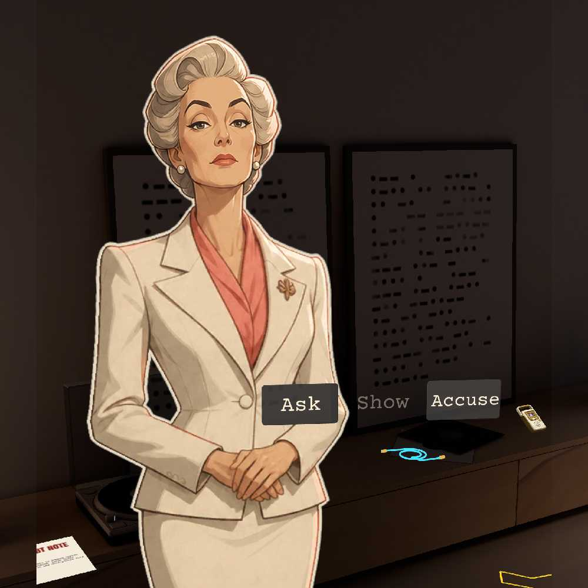
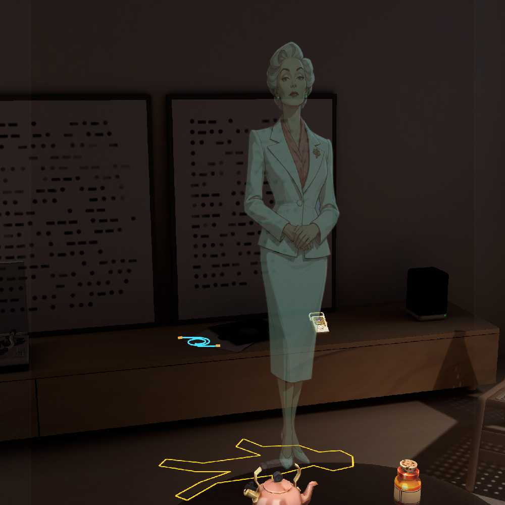
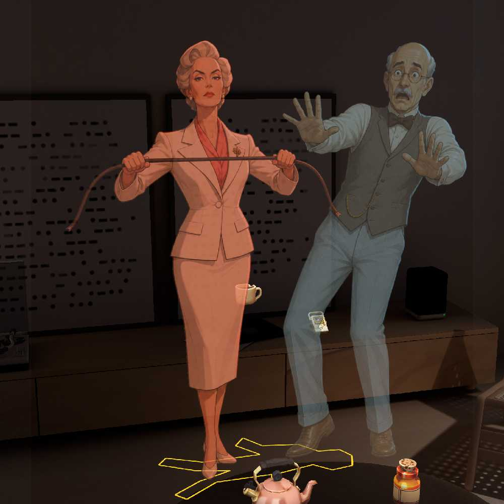
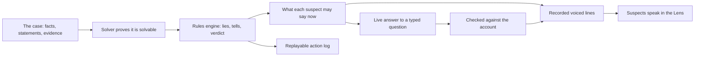

# Roomscript

**A murder mystery in your own room, for Snap Spectacles.** Harlow is dead and four guests were in the house. Walk up to them, ask in their own voices, find what they left behind, show it to them, catch the lie and name the killer.

The suspects are performed by AI voices, but they can't make things up. A deterministic rules engine owns every fact, lie and verdict, so the case is always fair and always solvable.

Built for *Learn AR with SPECS*: planned with the Devpost Learn `plan-lens` skill, and built by coding agents through CLAD and the Lens Studio MCP.

**Demo video:** _add the YouTube link here_ · **Design brief:** [devpost/design-brief.md](devpost/design-brief.md)



## Who it's for
People who love murder-mystery games, escape rooms and detective board games: anyone who enjoys watching a character, testing their story and proving them wrong. A case takes about 15 minutes, in your own living room.

## How it plays
1. **The case opens.** Harlow's last voicemail plays. Four guests stand in your room, tape crosses your doorway, a chalk outline marks the floor and rain runs down your window. One pinch opens the case file.
2. **Find.** The evidence sits on real surfaces in your room: a kettle, Harlow's recorder, a charger cable, a letter, a torn debt note, a forged certificate. Pinch an item and the detective notices something ("Stone cold. Nobody made tea tonight.").
3. **Ask.** Walk up to a suspect and a row appears beside them: **Ask · Show · Accuse**. Ask offers up to four questions, or *Ask your own…* to type one. They answer in their own voice, with subtitles under their face, and a tell gives away a lie.
4. **Show and catch.** Show them something you've found. If it breaks their story, they crack, and a ghost replays the truth at the spot where it happened.
5. **Accuse.** Face the killer, choose where and with what, and press the wax seal. Then walk around the frozen murder at 22:30 and read about it in the morning paper.

One voice speaks at a time and nobody is cut off. The row hides while someone talks. Every action is a single pinch.

| | |
|---|---|
|  |  |
| A caught lie replays the truth where it happened | Walk around the frozen murder |

## Why glasses
- **It draws in the world.** The suspects stand life-size in your room, the evidence sits on your surfaces, and the truth replays where it happened.
- **It leaves your body free.** You investigate by walking: up to a person to talk, over to the kettle to check it, back to show them.

On a laptop this would be menus and a list of clues. On glasses, your room is the crime scene.

## Fair AI: the truth engine


- The engine is plain deterministic TypeScript, shared by the Lens and the tests. It decides every fact, lie flag, tell and verdict.
- AI performs within what the engine allows. Answers to typed questions are generated live (Gemini through Snap's gateway, spoken with OpenAI text-to-speech) and checked before a word is spoken. A failed check falls back to a recorded line.
- Every action goes into a log that replays the whole case exactly.

## How it was built
- **Planning with plan-lens.** The Devpost Learn `plan-lens` skill turned the design into [a brief](devpost/design-brief.md) with preview-checkable done criteria, AR placement habits and preview stand-ins. We judged each build against its after-build checklist. When a playtest showed the game had grown too complicated, we rewrote the brief on the plan-lens template around one spatial moment (the cold kettle), and rebuilt the game from it.
- **Building with CLAD.** Codex and Claude Code built the Lens in Lens Studio through the CLAD plugin and the Lens Studio MCP, over ten build runs.
  - CLAD procedures: lens-studio-router, editor-api, lens-api, specs-build-ui, scene-construction, live-lens-tester, and build-mesh (with analyze_glb) for the 3D props.
  - MCP tools: VirtualScene for every scene change, RecompileTypeScriptTool and RunAndCollectLogsTool, CaptureRuntimeViewTool and ConvertSvgToTexture.
  - **Testing with LEAF:** every done criterion has a LEAF scenario that pinches through the Lens in Preview. Each visual change was captured and checked against the brief.
  - See the [CLAD log](devpost/clad-log.md).
- **Art and sound:**
  - the cast is stylised illustrations from an image model;
  - the props come from Snap's text-to-3D generator;
  - paper evidence is drawn in code;
  - voices are ElevenLabs designed voices for fictional characters.

  No real person's voice was cloned. See [NOTICE](NOTICE).

## Run it
1. Install [Git LFS](https://git-lfs.com) and clone with LFS objects (the art and audio live in LFS).
2. Open `RoomScriptF.esproj` in **Lens Studio 5.23.2**.
3. In the Preview panel choose **Spectacles**, **Interactive Preview**, and the Evening Room.
4. **Controls:**
   - right-drag to look;
   - WASD to walk, Q and E to go down and up;
   - click to pinch.
5. The case plays offline with recorded voices; no keys are needed. *Ask your own…* answers live only if you add your own Snap Remote Service Gateway credentials. Without them, a typed question gets the recorded answer for its closest topic.

Engine tests and a terminal version of the case:

```sh
cd Tooling
npm ci
npm test
npm run play -- --demo
```

Lens scripts compile inside Lens Studio, not with `tsc`. Before committing, install the secret-check hook with `git config core.hooksPath .githooks`.

## Verified (Nov 8, tag `run10-loop`)

| Check | Result |
|---|---|
| First-time player (LEAF, real pinches in Preview) | Solves the case in 25 pinches with no drags; first answer after 16 s |
| One voice at a time (full voiced play) | 17 lines, 0 overlaps, 0 cut short; subtitles matched the audio in all 879 samples |
| Row stability | 40 crossings of the range boundary, 0 flickers |
| Engine | 655 tests across 85 files; 5,000 generated cases fuzzed; the 76-action hero tape replays exactly |
| Secrets | Full-history scan, zero findings |

Details: [Run 10 report](docs/RUN10_REPORT.md).

## Limits
- Tested in Lens Studio's Preview with a simulated room, not on Spectacles hardware. Comfort, hand tracking and brightness are unproven until it's worn.
- The case is placed by hand in the Evening Room. Building new cases from a scan of your room is in the engine, but it isn't part of this version's experience.
- No voice input; every question is a button or typed.

## Repository
| Path | Contents |
|---|---|
| `Assets/Scripts/Engine/` | Deterministic case, solver, rules, performance checks and replay |
| `Assets/Scripts/Content/` | The Harlow Trust case, line banks and audio manifests |
| `Assets/Scripts/Roomscript*.ts` | Lens controllers, UI, actors and LEAF scenarios |
| `Tooling/` | Tests, terminal player, audio and art pipelines, the plan-lens skill |
| `devpost/` | Design brief, CLAD log, video plan and submission text |
| `docs/` | Design specs, run reports, decisions and captures |

## Licence and credits
Roomscript's code and procedural art are MIT-licensed, copyright 2026 Wadood. Snap packages and template content, the plan-lens skill (MIT, Devpost), and generated art and audio keep their own terms. See [LICENSE](LICENSE) and [NOTICE](NOTICE).
