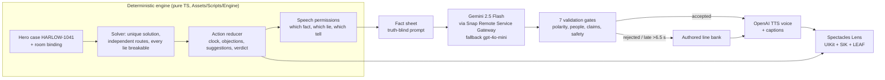

<!-- DRAFT for the repo root README.md. Replace every TODO before publishing. The numbers are from docs/ as of Oct 30; re-check them after the final run. -->

# Roomscript

**A murder mystery staged in your room, for Snap Spectacles. Clue's deduction meets L.A. Noire's interrogations, and the truth is decided by a deterministic engine, never by the AI.**

 <!-- TODO: 6 s GIF, under 8 MB, from the Fri capture -->

▶ **[3-minute demo video](TODO-youtube-link)** · Built for Snap's *Learn AR with SPECS* hackathon (Devpost) · Lens Studio 5.23.2 · Built by coding agents with **CLAD** and the **Lens Studio MCP**

> Captured in **Lens Studio Preview with a simulated room**. Not yet tested on Spectacles hardware. See [Known limitations](#known-limitations).

## The 30-second pitch

AI mystery games have a fatal flaw: the model makes up the facts, so the case can contradict itself and can't be solved fairly. Board-game mysteries are fair but static.

**Roomscript separates the two.**
- A TypeScript engine compiles the case: who, where, with what, every alibi, every lie and how it breaks. A solver proves it has exactly one solution.
- The AI only *performs*: suspects answer in their own words, and every line is validated against the engine's facts before it is spoken.
- Your room is the board. The case crate sits on your desk, suspects stand where they claim they were, and you break a lie by physically dragging a statement onto the object that contradicts it.

## Why glasses

<!-- Answers the brief template's question: "Would a phone do just as well?" -->
- **Suspects take up space.** They stand at the spots in the room they claim as alibis, so a lie is something you can *walk to*. On a phone the room collapses into a list.
- **Hands-free investigation.** You inspect objects, then drag a statement slip onto an object's memory card. The objection is a spatial gesture, not a menu.
- **Heads-up interrogation.** Tells (a gaze line that flicks to the object a suspect is hiding) only work if you are looking at the suspect *and* the room at the same time.

## What you do

1. **Place the case**: align the fixture markers and knock-knock. Pull the crate's tab; light, chalk outline and envelope appear and four suspects arrive.
2. **Interrogate** Qadir, Vale, Okafor and Pike. Learn each one's baseline, then watch for the tell.
3. **Objects remember**: inspect the kettle, the lamp, the window glass…
4. **OBJECTION!** Drag a contradicting statement or object memory onto the lie. Shards, proof thread, and the suspect retreats to her next account.
5. **Suggest** (Clue-style): drop a pawn in a room with a weapon. The refutation sweep circles the suspects.
6. **Accuse** Who / Where / With what. Hold the seal, then see the truth reconstruction, rating and case seal.

## Architecture: truth is compiled, not generated

The model never sees the hidden answer, and nothing it says can change the case. A rejected line is logged for audit but never enters the dialogue memory. **Stage mode** swaps live calls for authored answers and captions, so the whole case plays without network or keys.

## Verification: logic proven, feel unproven

| Evidence | Result |
|---|---|
| Vitest (pure engine, AI pipeline, tooling) | **411/411** in 37 files <!-- TODO re-run --> |
| Fuzzed players | 1,000 players / 29,487 actions: no repeat reward exploit, no loss of the true solution |
| Generated cases | 5,000/5,000 accepted by the solver across 5 room fixtures (`npm run test:fuzz`) |
| LEAF scenarios in Preview | 21 scenario scripts; opening, cast, clue, objection, closing, placement, speech and AI record/replay pass under the strict `fail-fast` policy <!-- TODO update after hero-demo --> |
| Live AI study (Preview, 28 calls) | Text p50/p95 2.4/4.4 s; first audio p50 5.1 s; 1/28 false rejection ([report](docs/production-study-2026-10-30.md)) |
| Validator red-team (Claude-generated, local) | 0/96 attacks accepted after fixes; 0/48 on a fresh holdout; still conservative on natural phrasing ([report](docs/validator-study-2026-10-30.md)) |
| Golden replay | Terminal hero tape verifies the case seal, 4 deductions, 3 objections and a correct verdict, offline |

**Feel unproven (device only):** floor alignment, additive-display readability, spatial audio, ray-drop comfort, keyboard/ASR, performance.

## Run it in Lens Studio Preview

1. Install **Lens Studio 5.23.2**. Newer versions had the Specs sign-in issue; the packages are pinned to 5.23.
2. Clone with LFS: `git lfs install && git clone <repo>`. Or use GitHub's "Download ZIP" (LFS included).
3. Open `RoomScriptF.esproj`. The saved scene starts in **Stage mode**, which needs no keys.
4. Preview: Interactive, SPECS. Follow the [10-minute Preview tour](docs/PREVIEW_TOUR.md).
5. *Optional live AI:* disable Stage mode and generate gateway tokens via *Window → Remote Service Gateway Token*. **Never commit them.** The tracked pre-commit hook (`git config core.hooksPath .githooks`) blocks populated token fields.

**Tests:** `cd Tooling && npm ci && npm test`. To play the terminal version: `npm run play -- --demo`.

## How it was built (agents, CLAD, Lens Studio MCP)

- **Agents:** Codex was the main builder, with parallel workers for pure engine and tooling packages. Claude Code handled design, planning and two independent review rounds (eight reports; confirm reviewer agent). Wadood directed scope, reviewed, and handled credentials and pauses.
- **CLAD** (`ls-clad`, installed at project scope; see `.claude/settings.json`):
  - skills used include specs-build-ui, specs-ai-remote-service, specs-audio, live-lens-tester/LEAF, scene-construction, shader-graph, vfx-graph, mesh-builder-scripting, interaction-recipes and build-sfx/build-music;
  - all SFX and music are procedurally generated with CLAD.
- **Lens Studio MCP:**
  - VirtualScene for every scene edit;
  - RecompileTypeScriptTool, RunAndCollectLogs, run_leaf_scenario, PreviewPanelTool/CaptureRuntimeViewTool for see-and-fix, plus PreviewInteractTool, MovePreviewCamera and ConvertSvgToTexture;
  - we found and wrote up an [MCP package-install bug](docs/mcp-bug-report.md).
- **Discipline:** one commit per verified work package (tags `m0-probe` → `m1-terminal` → `m2-slice`); tokens blanked before every commit; decisions logged.
- Full trail: [`devpost/clad-log.md`](devpost/clad-log.md) · [decisions](docs/decisions.md) · [plan](docs/plan/IMPLEMENTATION_PLAN.md) · [design](docs/design/) · [design brief](devpost/design-brief.md) · [reviews](docs/process/).

## Repository map

| Path | What |
|---|---|
| `Assets/Scripts/Engine/` | Pure deterministic engine: core, case, solver, game reducer, AI pipeline and validators |
| `Assets/Scripts/Content/` | Hero case HARLOW-1041, line bank, pitch library |
| `Assets/Scripts/Roomscript*.ts` | Lens components: controllers, UI, actors, LEAF scenarios |
| `Tooling/` | Vitest suite, fuzzers, terminal player, red-team harness, secret guard |
| `devpost/` | Hackathon planning and CLAD evidence |
| `docs/` | Design, plan, decisions, studies, captures, build process |
| `Packages/`, `Plugins/` | Snap Lens Studio packages (© Snap Inc., see NOTICE) |

## Known limitations

- Verified only in Lens Studio Preview with a simulated room. Placement uses manual calibration and fixture markers; there is no automatic room scan.
- One hand-authored hero case in the Lens. The case compiler generates and proves cases in tests but has no in-Lens casting UI yet.
- Live AI answers depend on the gateway. In Preview, 18 of 28 live answers were voiced in time; the rest fall back to captions. Stage mode is the reliable demo path.
- ASR/voice "Objection!" and Clue Night multiplayer are designed but not built.

## Credits and licence

- **Code and original assets:** © 2026 Wadood, licensed under TODO (MIT/Apache-2.0).
- **Third-party material:** CLAD-derived templates (Apache-2.0) and bundled Snap packages; see [NOTICE](NOTICE).
- **Voices:** AI-generated (OpenAI TTS via Snap Remote Service Gateway).
- **Trademarks:** Clue/Cluedo is a trademark of Hasbro, and L.A. Noire of Take-Two Interactive. Both are referenced for comparison only, with no affiliation.
